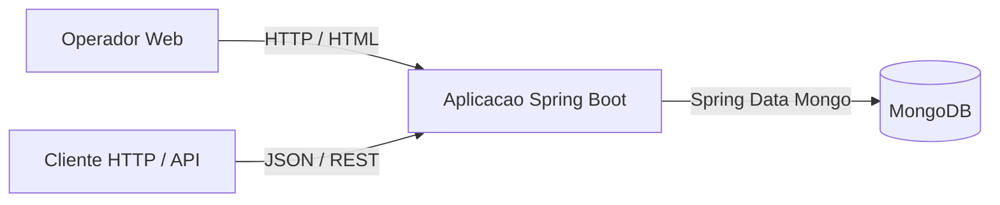
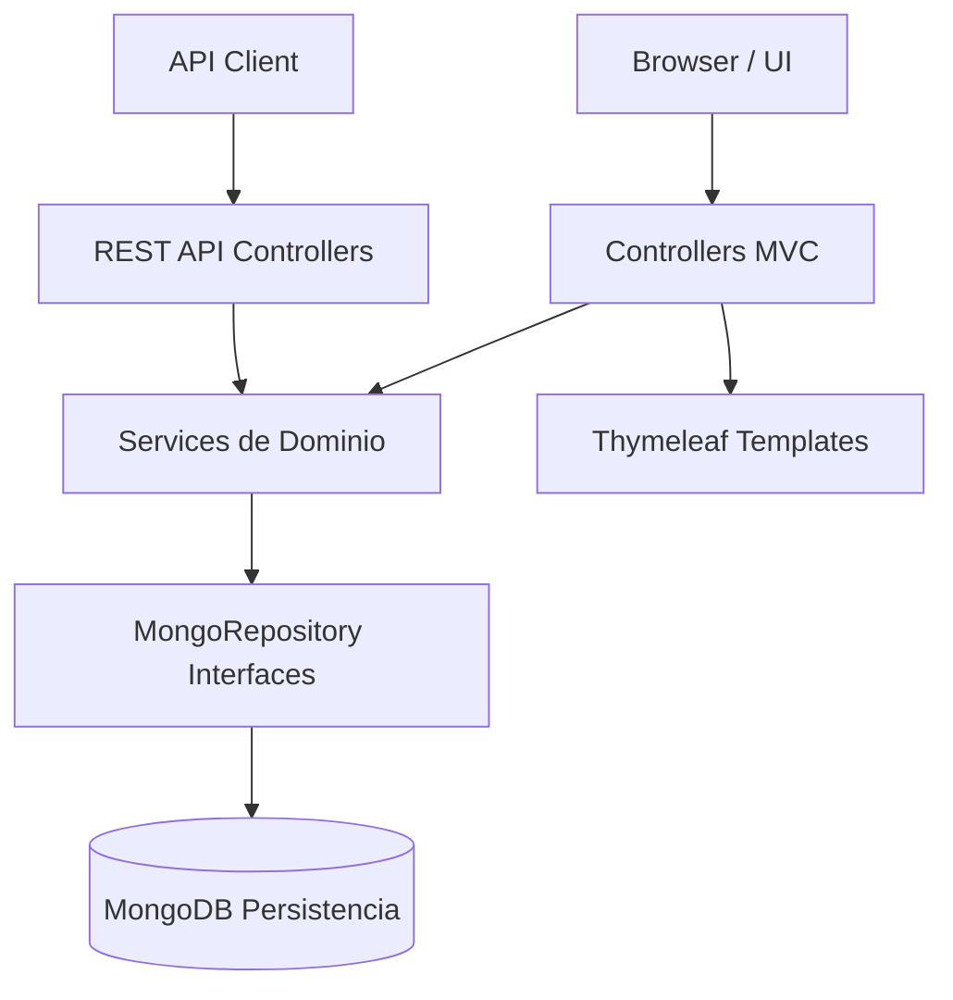
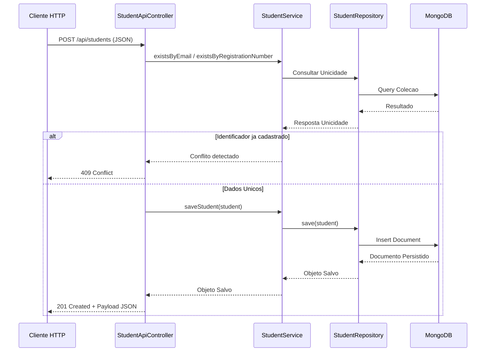

# Qualidade Educacional — Sistema de Gestao de Estudantes e Professores

[](https://www.oracle.com/java/)
[](https://spring.io/projects/spring-boot)
[](https://www.mongodb.com/)
[](https://maven.apache.org/)

Aplicacao Spring Boot para gestao educacional de estudantes e professores, oferecendo interface web interativa (Thymeleaf) e API REST completa. O projeto adota praticas rigorosas de Engenharia de Qualidade de Software, Integracao Continua (CI), cobertura de testes JaCoCo e controle formal de Release Candidates (`v1.0.0-rc1` / `v1.0.0-rc2`).

---

## 📋 Sumario

- [Visao Geral e Tecnologias](#-visao-geral-e-tecnologias)
- [Estrutura do Repositorio](#-estrutura-do-repositorio)
- [Arquitetura e Diagramas](#-arquitetura-e-diagramas)
- [Configuracao do Ambiente](#-configuracao-do-ambiente)
- [Como Executar o Projeto](#-como-executar-o-projeto)
- [Documentacao da API REST](#-documentacao-da-api-rest)
- [Governanca de Qualidade e Release](#-governanca-de-qualidade-e-release)
- [Equipe e Colaboradores](#-equipe-e-colaboradores)

---

## 🛠️ Visao Geral e Tecnologias

O sistema permite o cadastro, alteracao, remocao e listagem de estudantes e professores.

* **Linguagem:** Java 17
* **Framework Web:** Spring Boot 3.2.0
* **Banco de Dados:** MongoDB (Spring Data MongoDB)
* **Interface Web:** Thymeleaf + HTML5 / CSS3 / Bootstrap
* **Gerenciamento de Build:** Apache Maven / Maven Wrapper (`mvnw`)
* **Testes & Cobertura:** JUnit 5, Mockito, JaCoCo
* **CI/CD:** GitHub Actions (`.github/workflows/ci.yml`)

---

## 📁 Estrutura do Repositorio

```text
qualidade_software/
├── .github/
│   └── workflows/
│       └── ci.yml                 # Workflow de Integracao Continua no GitHub Actions
├── .mvn/
│   └── wrapper/                   # Binarios e configuracoes do Maven Wrapper
├── docs/                          # Pacote completo de evidencias e documentacao
│   ├── defeitos/                  # Triagem e registro de defeitos (D-001, D-002)
│   ├── entrega/                   # Checklists de clone limpo e entregaveis
│   ├── evidencias/                # Indices de relatorios de CI e cobertura JaCoCo
│   ├── performance/               # Plano e resultados de testes de carga
│   ├── testes/                    # Plano e resultados de testes unitarios/integracao
│   ├── api.md                     # Especificacao detalhada dos endpoints HTTP
│   ├── arquitetura.md             # Modelagem de componentes e contexto (Mermaid)
│   ├── criterios.md               # Critérios de aceite e gates de qualidade
│   ├── decisao-qualidade.md       # Relatorio de decisao formal de release
│   ├── fse.md                     # Especificacao funcional e de qualidade
│   └── relatorio-qualidade.md     # Relatorio provisorio de preparacao da RC
├── src/
│   ├── main/
│   │   ├── java/com/example/educationalqualityproject/
│   │   │   ├── controller/        # Controllers Web MVC e API REST
│   │   │   ├── entity/            # Documentos MongoDB (Student, Teacher)
│   │   │   ├── repository/        # MongoRepository interfaces
│   │   │   └── service/           # Regras de negocio e validacao de unicidade
│   │   └── resources/
│   │       ├── templates/         # Paginas HTML Thymeleaf
│   │       └── application.properties # Configuracoes do Spring Boot e MongoDB
│   └── test/                      # Testes automatizados com JUnit 5 / Mockito
├── CHANGELOG.md                   # Historico de alteracoes por versao
├── mvnw / mvnw.cmd                # Executaveis do Maven Wrapper (Linux/Windows)
├── pom.xml                        # Configuracao de dependencias e plugins Maven
└── README.md                      # Documentacao principal do projeto
```

---

## 📐 Arquitetura e Diagramas

### Contexto do Sistema



### Diagrama de Componentes



### Fluxo de Sequencia: Criacao de Estudante via API REST



---

## ⚙️ Configuracao do Ambiente

### 1. Requisitos
* **Java Development Kit (JDK):** Versao 17 instalada e configurada na variavel `JAVA_HOME`.
* **MongoDB:** Instancia ativa local (`localhost:27017`) ou banco remoto (ex.: Railway Proxy).

### 2. Variaveis de Ambiente do MongoDB
A aplicacao le a string de conexao pela propriedade `MONGODB_URI` no arquivo `src/main/resources/application.properties`:

```properties
spring.data.mongodb.uri=${MONGODB_URI:mongodb://localhost:27017/educational_quality}
```

Para definir a variavel no terminal antes de rodar o projeto:

* **Windows (CMD):**
  ```cmd
  set MONGODB_URI=mongodb://crossover.proxy.rlwy.net:24258/educational_quality
  ```
* **PowerShell / Linux / macOS:**
  ```bash
  $env:MONGODB_URI="mongodb://crossover.proxy.rlwy.net:24258/educational_quality"
  ```

---

## 🚀 Como Executar o Projeto

Nao e necessario instalar o Maven globalmente. O projeto contem o **Maven Wrapper (`mvnw`)** configurado na raiz.

### Compilacao e Ejecucao dos Testes (Verify)

```cmd
# No Windows CMD:
mvnw.cmd clean verify

# No Linux / macOS / Bash:
./mvnw clean verify
```

### Iniciar o Servidor Web localmente

```cmd
# No Windows CMD:
mvnw.cmd spring-boot:run

# No Linux / macOS / Bash:
./mvnw spring-boot:run
```

Apos iniciar, acesse:
* **Interface Web:** `http://localhost:8080`
* **API REST Estudantes:** `http://localhost:8080/api/students`
* **API REST Professores:** `http://localhost:8080/api/teachers`

---

## 🌐 Documentacao da API REST

### Recursos de Estudantes (`/api/students`)

| Metodo | Caminho | Resposta de Sucesso | Codigos de Erro |
|---|---|---|---|
| `GET` | `/api/students` | `200 OK` (Array JSON) | — |
| `GET` | `/api/students/{id}` | `200 OK` (Objeto JSON) | `404 Not Found` |
| `POST` | `/api/students` | `201 Created` (Objeto salvo) | `409 Conflict` (E-mail ou Matrícula em uso) |
| `PUT` | `/api/students/{id}` | `200 OK` (Objeto alterado) | `404 Not Found`, `409 Conflict` |
| `DELETE`| `/api/students/{id}` | `204 No Content` | `404 Not Found` |

#### Payload Exemplo (`POST /api/students`):
```json
{
  "name": "Ada Lovelace",
  "email": "ada@example.test",
  "registrationNumber": "ST-100"
}
```

---

### Recursos de Professores (`/api/teachers`)

| Metodo | Caminho | Resposta de Sucesso | Codigos de Erro |
|---|---|---|---|
| `GET` | `/api/teachers` | `200 OK` (Array JSON) | — |
| `GET` | `/api/teachers/{id}` | `200 OK` (Objeto JSON) | `404 Not Found` |
| `POST` | `/api/teachers` | `201 Created` (Objeto salvo) | `409 Conflict` (E-mail em uso) |
| `PUT` | `/api/teachers/{id}` | `200 OK` (Objeto alterado) | `404 Not Found`, `409 Conflict` |
| `DELETE`| `/api/teachers/{id}` | `204 No Content` | `404 Not Found` |

#### Payload Exemplo (`POST /api/teachers`):
```json
{
  "name": "Grace Hopper",
  "email": "grace@example.test",
  "department": "Computing"
}
```

---

## 🛡️ Governanca de Qualidade e Release

O projeto segue padroes formais para liberacao de versoes:

1. **Politica de Tags:** Tags anotadas Git (`v1.0.0-rc1`, `v1.0.0-rc2`) sao imutaveis. Qualquer ajuste gera uma nova Release Candidate (ex.: `v1.0.0-rc2`).
2. **Quality Gates:** 
   - Compilacao limpa e sem falhas via `./mvnw -B clean verify`.
   - Relatorios de cobertura de código JaCoCo.
   - Execucao de pipeline automatizada no GitHub Actions.
3. **Decisao de Qualidade (`docs/decisao-qualidade.md`):** Documento conclusivo contendo os criterios validados, riscos aceitos e declaracao dos integrantes do grupo.

---

## 👥 Equipe e Colaboradores

- **Nicolas Thomaz** — Owner do Repositorio / Desenvolvedor
- **Joao Cavanhass** — Integrante / Engenheiro de Qualidade

---

*Projeto desenvolvido como atividade da disciplina de Qualidade de Software.*
