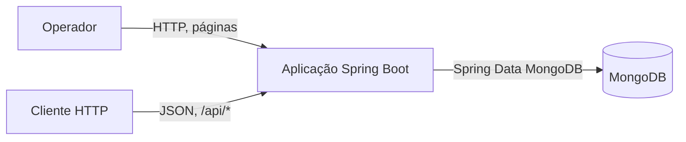
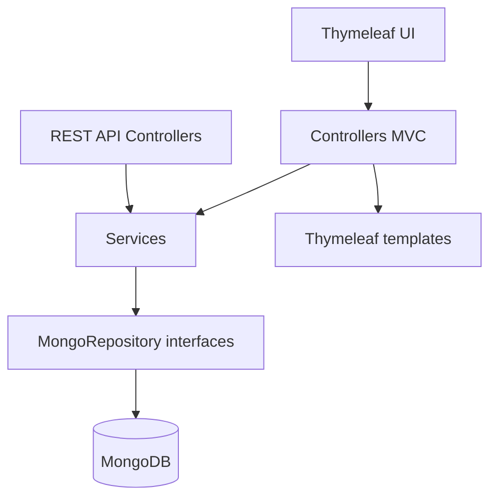
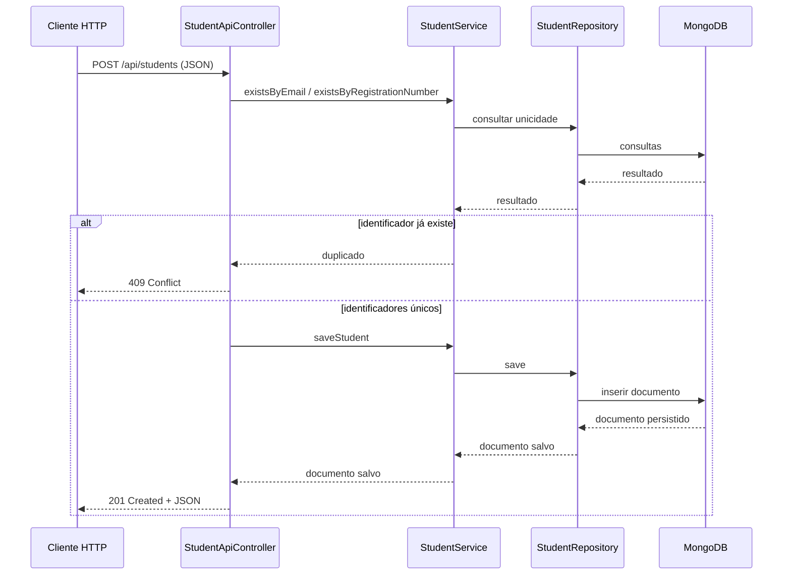

# Arquitetura e diagramas

**Estado:** documentação inicial para revisão; não aprovada para release.

## Contexto

## Componentes

## Sequência: criação de estudante pela API

## Componentes de produção

- `controller/`: páginas Thymeleaf e endpoints REST.
- `service/`: delegação de operações de domínio para repositórios.
- `repository/`: interfaces Spring Data MongoDB.
- `entity/`: documentos `Student` e `Teacher`.
- `resources/templates/`: páginas web.

O banco deve ser provisionado externamente e configurado por
`MONGODB_URI`. O teste de contexto do Spring e os testes MVC com serviços
mockados não comprovam a disponibilidade do banco remoto.
